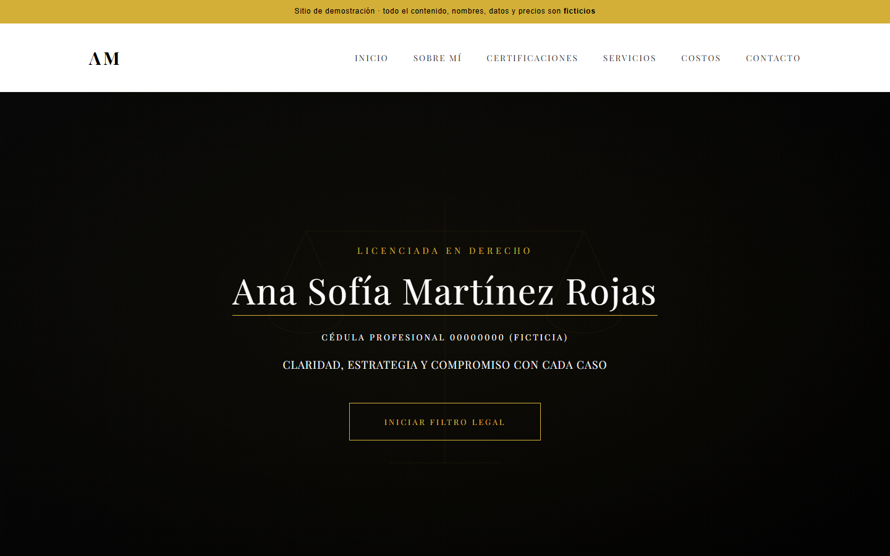
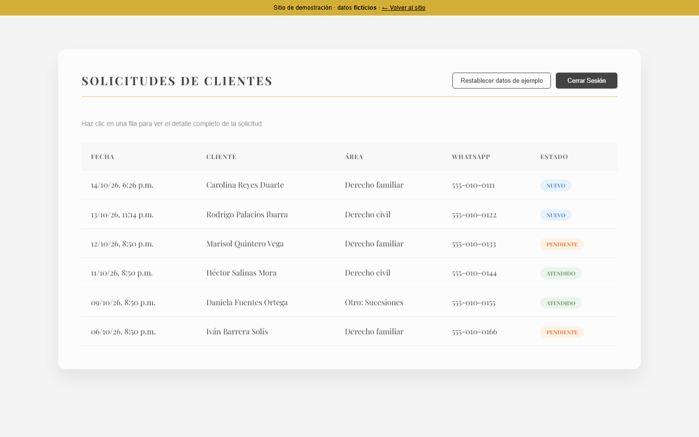
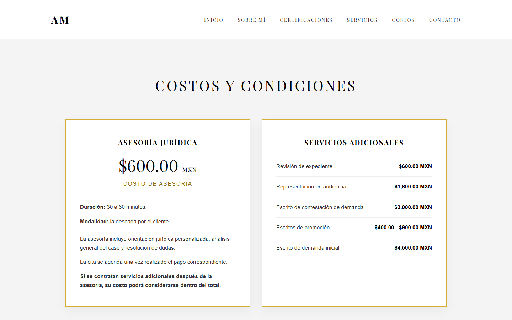
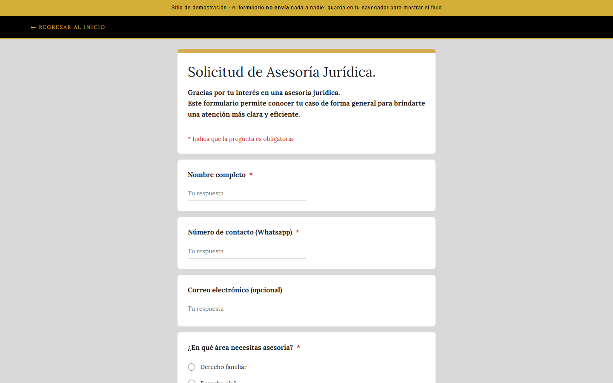
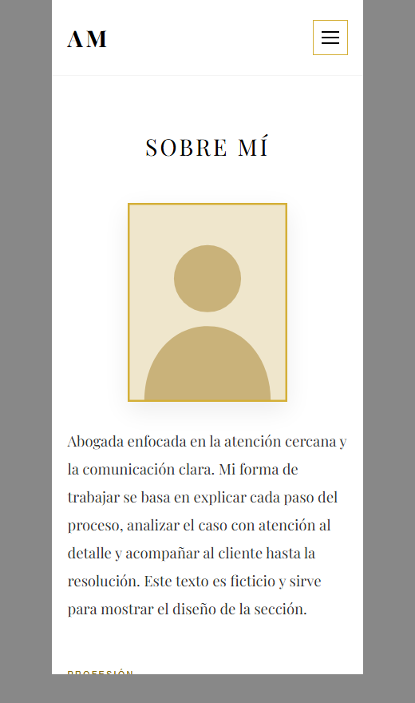
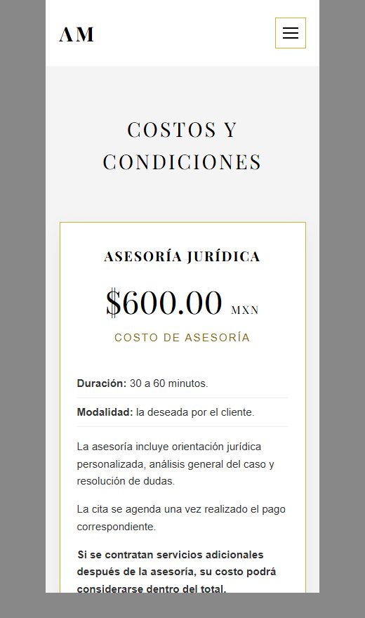

# Landing para abogada con filtro de clientes — versión demo

Sitio web profesional para una abogada: presentación (perfil, experiencia, certificaciones, servicios, costos y contacto), un **Filtro Legal** (formulario para pre-calificar a quien quiere agendar una cita) y un **panel administrativo** para revisar las solicitudes.

> **Esta es una versión de demostración.** Está basada en un proyecto real que desarrollé para un cliente (familiar), pero **todo el contenido es ficticio**: nombre, cédula, teléfono, correo, dirección, certificaciones, precios y solicitudes.

HTML + CSS + JavaScript puro. Sin dependencias ni paso de compilación. Responsive (con menú para celular).

## Capturas

| Inicio (escritorio) | Panel de solicitudes |
|---|---|
|  |  |

| Costos | Formulario |
|---|---|
|  |  |

| Celular: Sobre mí | Celular: Costos |
|---|---|
|  |  |

## Qué incluye

- Landing de una página: encabezado, Sobre mí, Formación, Servicios, Costos y Contacto.
- Navegación con menú desplegable en celular.
- Formulario de solicitud de asesoría con validación (campos obligatorios, opción "Otro", casillas con al menos una selección, confirmación al enviar).
- Panel de administración con tabla de solicitudes, estados (Nuevo / Pendiente / Atendido) y detalle al hacer clic.
- Capa de datos aislada (`store.js`): el formulario y el panel solo hablan con dos funciones, así que conectar un servidor real no obliga a reescribir la interfaz.
- Medidas básicas: todo lo que escribe un visitante se muestra con `textContent` (no `innerHTML`) para evitar inyección de código en el panel.

## Qué NO incluye (y por qué lo digo)

- **No hay servidor ni base de datos.** Las solicitudes se guardan en `localStorage`, es decir, solo en el navegador de quien usa la página. Nada se envía a nadie.
- **El inicio de sesión del panel es solo visual** (usuario `demo` / contraseña `demo`). En un sistema real, la autenticación debe verificarse en el servidor.
- No hay envío de correos, pagos ni agenda en línea.

La siguiente etapa natural (y la que seguiría en un proyecto real) es un backend con base de datos, login verificado en servidor, notificación por correo, aviso de privacidad y protección anti-spam.

## Estructura

| Archivo | Qué es |
|---|---|
| `index.html` · `styles.css` · `nav.js` | Landing y menú móvil |
| `encuesta.html` · `encuesta.css` · `encuesta.js` | Filtro Legal (formulario) |
| `store.js` | Capa de datos (`enviarSolicitud`, `listarSolicitudes`, `restablecerDemo`) |
| `admin.html` · `admin.css` · `admin-solicitudes.js` | Panel de administración |
| `img/` | Imágenes propias en SVG (fondo, ilustración de retrato, ícono) |

## Cómo verlo

```bash
python -m http.server 8000   # y abrir http://localhost:8000
```

También se puede abrir `index.html` directamente.

## Tecnologías

HTML5 · CSS3 (Flexbox, media queries) · JavaScript (ES6, `localStorage`) · Despliegue en Vercel.

## Desarrollo

Diseño y desarrollo: Javier. Proyecto realizado con asistencia de IA; el código fue revisado y probado por mí.
